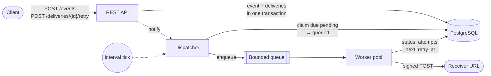
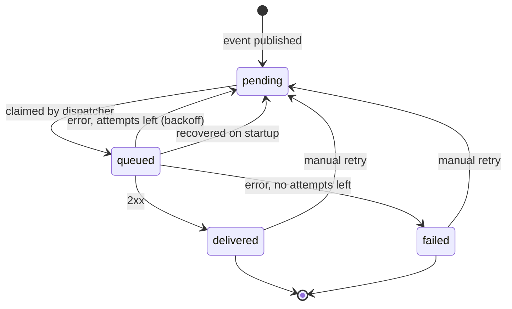

# Webhook Delivery


A reliable webhook delivery service. Applications register receiver endpoints, subscribe them to event types, and publish events — the service fans each event out to its subscribers and guarantees delivery over HTTP with retries, exponential backoff, and HMAC-signed requests. Every delivery attempt is tracked with its own status, retry schedule, and last response.

This is the machinery behind the webhooks of services like Stripe or GitHub: the side that dispatches notifications to third-party URLs and takes on the dirty work of reliable delivery.

---

## Quick Start

### Prerequisites

- Docker + Docker Compose
- (for local runs) Go 1.26+, PostgreSQL and [Task](https://taskfile.dev)

### Environment variables

| Variable      | Description                                              | Required |
|---------------|----------------------------------------------------------|----------|
| `CONFIG_PATH` | Path to the YAML config file                             | Yes      |
| `DB_USERNAME` | Postgres user                                            | Yes      |
| `DB_PASSWORD` | Postgres password                                        | Yes      |
| `DB_NAME`     | Postgres database name (`hookrelay` in Docker Compose)   | Yes      |
| `API_KEY`     | Key expected in the `X-Api-Key` header; if empty, auth is skipped with a warning | No |

Copy `.env.example` to `.env` (loaded automatically) or provide the variables via the environment. For Docker use `config/dev.yaml` (its `db.addr` points at the `postgres` service); for host runs use `config/local.yaml` (`localhost`).

### Run with Docker

```bash
docker-compose up --build
```

Brings up PostgreSQL and the service; migrations are applied automatically on startup. The API is exposed on `localhost:5428`, Swagger UI on `localhost:5428/swagger/`.

### Run locally

```bash
task migrate:up               # apply database migrations
go run ./cmd/webhook-delivery # start the service (serves on :8080)
```

### Try it

```bash
# 1. register an endpoint subscribed to order.created (save the returned secret)
curl -X POST localhost:8080/api/v1/endpoints \
  -H "X-Api-Key: $API_KEY" -H "Content-Type: application/json" \
  -d '{"url": "https://example.com/webhooks", "event_types": ["order.created"]}'

# 2. publish an event — payload is any JSON object
curl -X POST localhost:8080/api/v1/events \
  -H "X-Api-Key: $API_KEY" -H "Content-Type: application/json" \
  -d '{"type": "order.created", "payload": {"order_id": 42}}'

# 3. watch its deliveries
curl localhost:8080/api/v1/events/ev_.../deliveries -H "X-Api-Key: $API_KEY"
```

---

## Features

- **OpenAPI-first** — the spec in `api/openapi/v1/openapi.yaml` is the source of truth; server interfaces and models are generated with oapi-codegen (strict server), and every request is validated against the spec before reaching a handler
- **API key auth** — all `/api/v1` routes require an `X-Api-Key` header (`401` when missing, `403` when wrong, constant-time comparison)
- **Endpoint registration** — register a receiver URL; a per-endpoint signing secret (`whsec_…`) is generated automatically and returned once
- **Event subscriptions** — subscribe an endpoint to specific event types; subscribing is idempotent (`ON CONFLICT DO NOTHING`), only new subscriptions are returned
- **Atomic event fan-out** — publishing an event and creating one `pending` delivery per active subscribed endpoint happen in a single transaction
- **Reliable delivery** — a dispatcher claims due deliveries from Postgres and feeds a bounded worker pool; deliveries are retried with exponential backoff with jitter up to a per-delivery `max_attempts`
- **Instant dispatch** — publishing or retrying wakes the dispatcher immediately; the polling interval is only a safety net
- **Crash recovery** — deliveries left `queued` / `processing` by a stopped instance are reset to `pending` on startup
- **Manual retry** — any delivery can be retried, resetting its attempts
- **HMAC request signing** — every delivered request carries an `X-Webhook-Signature` header (HMAC-SHA256 of the body)
- **SSRF protection** — endpoint URLs are validated on registration and update; loopback, link-local and `localhost` targets are rejected
- **Public prefixed IDs** — UUIDv7 primary keys in Postgres (index-friendly, time-ordered), exposed as `ep_…`, `sub_…`, `ev_…`, `del_…` in the API
- **Postgres-backed queue** — no external broker; pending deliveries are claimed straight from Postgres via a partial index
- **Graceful shutdown** — workers, the dispatcher and the HTTP server stop cleanly on `SIGINT` / `SIGTERM`

---

## Tech Stack

| Component            | Technology                                                                     |
|----------------------|--------------------------------------------------------------------------------|
| **Language**         | Go 1.26+                                                                       |
| **HTTP Router**      | [chi](https://github.com/go-chi/chi)                                           |
| **API**              | [oapi-codegen](https://github.com/oapi-codegen/oapi-codegen) (chi + strict server, embedded spec) |
| **Request validation** | [kin-openapi](https://github.com/getkin/kin-openapi) via [nethttp-middleware](https://github.com/oapi-codegen/nethttp-middleware) |
| **API docs**         | Swagger UI ([swgui](https://github.com/swaggest/swgui)) served from the embedded spec |
| **Database / Queue** | PostgreSQL — native [pgx v5 / pgxpool](https://github.com/jackc/pgx)           |
| **IDs**              | UUIDv7 ([google/uuid](https://github.com/google/uuid))                         |
| **Migrations**       | [golang-migrate](https://github.com/golang-migrate/migrate)                    |
| **Config**           | [cleanenv](https://github.com/ilyakaznacheev/cleanenv) + godotenv (YAML + env) |
| **Logging**          | slog (structured JSON / text)                                                  |
| **Testing**          | testify + [uber-go/mock](https://github.com/uber-go/mock) + [testcontainers-go](https://github.com/testcontainers/testcontainers-go) |
| **Containerization** | Docker + Docker Compose                                                        |

---

## Architecture

Layers with dependencies pointing inward, wired through interfaces declared on the consumer side:

- **`delivery/rest`** — strict handlers generated from the OpenAPI spec, one package per resource (`endpoints`, `subscriptions`, `events`, `deliveries`) with mappers between API models and domain types; middlewares for API key auth and request logging
- **`services`** — business logic; each service depends on repository interfaces, not concrete drivers
- **`services/workers`** — the delivery pipeline: dispatcher and worker pool
- **`infrastructure/pg`** — pgxpool repositories (one file per aggregate); transactions are opened where an operation needs them, e.g. publishing an event together with its deliveries
- **`domain`** — entities, commands, error values and public ID prefixes, free of framework code
- **`app`** — wiring: builds repositories, services, workers and the HTTP server, runs migrations on startup

Generated code lives in `gen/rest/v1` and is never edited by hand.

---

## API

All routes are mounted under `/api/v1` and require the `X-Api-Key` header. The full contract — request and response schemas, error codes — is in [`api/openapi/v1/openapi.yaml`](api/openapi/v1/openapi.yaml); in non-prod environments Swagger UI is served at `/swagger/`. Delivery dispatch is an internal pipeline and has no public endpoint.

Errors share one shape: `{"code": "endpoint_not_found", "message": "endpoint not found"}`. Malformed or unknown IDs are answered with `404`, the same as missing resources.

### Endpoints

| Method   | Path                     | Description                                          |
|----------|--------------------------|------------------------------------------------------|
| `POST`   | `/api/v1/endpoints`      | Register a receiver URL (returns its signing secret) |
| `GET`    | `/api/v1/endpoints`      | List endpoints (paginated)                           |
| `GET`    | `/api/v1/endpoints/{id}` | Get a single endpoint                                |
| `PATCH`  | `/api/v1/endpoints/{id}` | Update URL / active state / description              |
| `DELETE` | `/api/v1/endpoints/{id}` | Delete an endpoint with its subscriptions and deliveries |

### Subscriptions

| Method   | Path                                   | Description                          |
|----------|----------------------------------------|--------------------------------------|
| `POST`   | `/api/v1/endpoints/{id}/subscriptions` | Subscribe an endpoint to event types |
| `GET`    | `/api/v1/endpoints/{id}/subscriptions` | List an endpoint's subscriptions     |
| `DELETE` | `/api/v1/subscriptions/{id}`           | Remove a subscription                |

### Events

| Method | Path                             | Description                                 |
|--------|----------------------------------|---------------------------------------------|
| `POST` | `/api/v1/events`                 | Publish an event → fans out to subscribers  |
| `GET`  | `/api/v1/events/{id}`            | Get an event by id                          |
| `GET`  | `/api/v1/events/{id}/deliveries` | List deliveries of an event (paginated)     |

### Deliveries

| Method | Path                            | Description                                     |
|--------|---------------------------------|-------------------------------------------------|
| `GET`  | `/api/v1/deliveries/{id}`       | Get a single delivery                           |
| `POST` | `/api/v1/deliveries/{id}/retry` | Retry a `delivered` or `failed` delivery; `409` if it is still active |

Pagination uses `page` (from 1, default 1) and `limit` (1–100, default 10) query parameters.

---

## Delivery Pipeline

Publishing an event fans it out into one `pending` delivery row per active subscribed endpoint, in the same transaction as the event itself. A single dispatcher and a pool of workers then drive those rows to completion:

1. **Claim** — the dispatcher claims up to `min(free queue slots, batch_size)` due `pending` deliveries, oldest `next_retry_at` first, and marks them `queued` in the same statement. It runs on every `interval` tick and immediately when an event is published or a delivery is retried. Claiming only what the queue can take is the backpressure: nothing sits in memory waiting for a worker.
2. **Deliver** — a worker `POST`s the payload to the endpoint URL with an `X-Webhook-Signature` header. The URL and secret are read from the endpoint on every claim, so an updated endpoint takes effect on the next attempt. Any `2xx` marks the delivery `delivered`.
3. **Reschedule** — on any other response or a transport error the attempt is counted, `next_retry_at` is pushed back by an exponential backoff with jitter (capped by `max_backoff`) and the delivery returns to `pending`; once attempts reach the delivery's `max_attempts` it becomes `failed`. The last response code and error are recorded on the row either way.
4. **Recover** — on startup, deliveries left `queued` or `processing` by a previous run are reset to `pending`, so a crash or restart never loses work.



Each delivery moves through these statuses:



```yaml
workers:
  max_goroutines: 5   # worker pool size
  max_attempts: 5     # stored on each delivery when it is created
  timeout: 10s        # per-request timeout to the receiver
  base_backoff: 10s
  max_backoff: 1h
  queue_size: 20      # in-memory queue between dispatcher and workers
dispatcher:
  interval: 4s        # polling safety net
  batch_size: 20      # max deliveries claimed per dispatch
```

The service is designed to run with a single dispatcher instance.

---

## Signature Verification (receiver side)

Every delivered request carries an `X-Webhook-Signature` header — a hex-encoded HMAC-SHA256 of the raw request body, computed with the endpoint's secret. The receiver repeats the computation with its own copy of the secret and compares the two, confirming the request came from this service and was not forged or tampered with:

```go
mac := hmac.New(sha256.New, []byte(secret))
mac.Write(body)
expected := hex.EncodeToString(mac.Sum(nil))

if !hmac.Equal([]byte(expected), []byte(r.Header.Get("X-Webhook-Signature"))) {
	// reject the request
}
```

---

## Testing

- **Unit tests** — table tests for handlers, services and workers with generated mocks (`task mocks` regenerates them next to their sources)
- **Integration tests** — repositories are tested against a real PostgreSQL 17 started by testcontainers, with all migrations applied; they live behind the `integration` build tag and need a running Docker

```bash
task test              # unit tests
task test:cover        # unit tests + coverage.html
task test:integration  # integration tests (Docker required)
```

Other handy tasks: `task generate:api` (regenerate code from the OpenAPI spec), `task lint`, `task migrate:down`.

---

## CI

Every push and pull request to `master` / `development` runs the **CI** workflow:

- **test** — `go build`, `go vet`, and `go test -race` across all packages
- **lint** — `golangci-lint`

---

## Configuration

`config/local.yaml`:

```yaml
env: "local" # local, dev, prod
http_server:
  port: 8080
  write_timeout: 5s
  read_timeout: 10s
db:
  addr: "localhost:5432"
  connection_timeout: 5s
workers:
  max_goroutines: 5
  max_attempts: 5
  timeout: 10s
  base_backoff: 10s
  max_backoff: 1h
  queue_size: 20
dispatcher:
  interval: 4s
  batch_size: 20
```

In `prod` Swagger UI is disabled.

---

## Security

- All API routes are protected by an API key compared in constant time
- Each endpoint gets a signing secret (`whsec_…`, 32 random bytes from `crypto/rand`), returned only on registration; payloads are signed with HMAC-SHA256 so receivers can verify authenticity
- Endpoint URLs are SSRF-checked on registration and update — loopback, link-local and `localhost` targets are rejected
- Postgres is accessed through a pooled connection with parameterized queries throughout
- Credentials (DB user / password, API key) are supplied via environment, never committed to the config file
